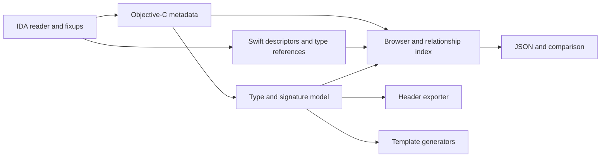

# Next features and project identity

Exploration dated 2026-09-09, after compatibility commit `b9a230e`.
The stages below describe proposed work beyond the shipped features. A later
follow-up added basic Objective-C header export with a module-derived filename;
the full type registry, JSON export, preview and template generators remain
proposals. The original compatibility baseline and its remaining GUI/cache
coverage limits are in [validation.md](validation.md).

## Recommendation

Build a shared type/signature model first, then use it for readable declarations,
class-dump headers and code templates. Develop Swift metadata inspection as a
separate parser using the existing reader and the same browser infrastructure.
Keep the native IDA frontend: the chooser and graph APIs provide the necessary
controls without a Python Qt dependency.

| Stage | Deliverable | Completion evidence |
| --- | --- | --- |
| 1 | Objective-C signature AST, readable members, structured JSON export | Compiler-generated fixture encodings match; malformed inputs give bounded partial results |
| 2 | Header export and preview; selector search and reference inspection | Generated supported headers compile; GUI selection, copy and export work |
| 3 | Swift types, fields, protocols and conformance inspector | Known fixture names/relationships match; absent metadata remains explicit |
| 4 | Inheritance/conformance graphs, type application and metadata comparison | Graph edges retain evidence; database changes preserve user types; deterministic comparisons |
| 5 | Objective-C swizzling and Frida template generators | Generated templates compile/run against a project-owned toy application and preserve original behavior |

Stages 2 and 3 can proceed in parallel once the shared record identities and
export schema exist. Before a compatibility release, also test a complete real
dyld cache and reproduce the remaining native GUI crash on another supported
macOS/IDA combination. These are open validation tasks, not completed coverage.

## Objective-C signatures and class dump

Use a bounded recursive parser, not string substitutions. Its nodes should
represent primitive types, objects/protocol qualifications, classes, selectors,
pointers, arrays, records, unions, bitfields, qualifiers, blocks and unknown
tokens. Retain raw text and spans, including encoded frame/argument offsets.
A method model separates the return value, hidden `self`/`_cmd` and explicit
arguments. Match selector components to explicit arguments and diagnose
inconsistent counts.

For example, selector `setCount:` and encoding `v24@0:8q16` can produce
`- (void)setCount:(long long)arg0;`. The name `arg0` is generated; a source
typedef such as `NSInteger` cannot be inferred from `q` alone. Ordinary method
encodings can omit object class names and block parameter types. Variadic
arguments, source typedefs, nullability and original argument names are not
generally recoverable. Packed/aligned record layout also cannot always be
reconstructed from the encoding. Extended encodings can supply additional
information. Preserve these distinctions instead of silently inventing types.
[Clang's encoding implementation](https://github.com/llvm/llvm-project/blob/main/clang/lib/AST/ASTContext.cpp)

Decode property attributes separately: declared type, ownership, readonly,
nonatomic, custom accessors and backing ivar. Emit implementation-only details
as comments. Header output should include instance/class methods, required and
optional protocol sections, category declarations and adoption lists. Resolve
forward declarations and record/superclass dependencies through a type registry;
an absent external superclass or conflicting record definition remains a
diagnostic. Apple's runtime exposes method encodings and property attributes as
distinct sources.
[Objective-C runtime declarations](https://github.com/apple-oss-distributions/objc4/blob/main/runtime/runtime.h)

Offer two explicit outputs: an inspection header that retains unresolved
declarations as comments, and a compilable subset whose prerequisites are
known. Include a manifest of omitted members and required external definitions.
Stable synthetic argument/field names and consistent ordering make diffs useful.
Preserve the existing raw inspection dump as an export option.

Suggested modules: `type_encoding.py`, `declarations.py`, `type_registry.py`,
`exporters/headers.py`, and `exporters/json.py`. Keep them independent of IDA.
Tests should compare compiler/runtime encodings for project-owned fixtures and
compile the supported headers for arm64 and x86_64. Include nested declarators,
cyclic references, anonymous aggregates, block types, malformed strings and
selector/argument mismatches.

## GUI tools

The next GUI additions can mostly reuse parsed information:

| Tool | User benefit | Implementation boundary |
| --- | --- | --- |
| Global selector/member search | Find a selector across classes, categories and protocols | Indexed rows with kind/module filters; retain all duplicate owners |
| Member details | Read a declaration alongside its encoding and metadata address | Show parsed, inferred and unresolved fields; jump separately to metadata and implementation |
| References pane | Follow selector/class references and implementation xrefs | Label reference kind; a selector reference alone does not prove a dispatch target |
| Export preview | Inspect/copy a selected class, module or whole dump | Native text viewer with explicit save/copy actions and diagnostics |
| Relationship graph | Explore inheritance, protocol adoption and category attachments | Separate edge kinds, external nodes and bounded expansion |
| Apply signature | Improve IDA's function types after review | Preview differences; retain existing user declarations; support undo |
| Compare metadata | See added/removed members and signature changes between builds | Versioned JSON, normalized addresses and separate ABI/annotation changes |

Use native `Choose` quick filters and `simplecustviewer_t` for text previews;
use `ida_graph.GraphViewer` for relationship graphs. These APIs are present in
the installed IDA 9.4 SDK. Validate popup actions, keyboard interaction and
close/reopen behavior on a stable GUI host before adding more windows.
[IDAPython UI API](https://python.docs.hex-rays.com/ida_kernwin/index.html),
[Graph API](https://python.docs.hex-rays.com/ida_graph/index.html)

Type application should build detached `tinfo_t` objects first and apply only
reviewed signatures. A C representation of an IMP includes the hidden receiver
and selector; encoded offsets are not a register-allocation specification.
[IDA type API](https://python.docs.hex-rays.com/ida_typeinf/index.html)

Introduce a per-database record index with identity based on image identity,
metadata address and record kind. Keep raw values, resolved addresses and
diagnostics attached to each record. For cross-build comparisons, match qualified
names/selectors and report ambiguous matches; do not treat an address as a
stable identity across builds. Refresh explicitly after reanalysis or rebasing.

## Swift inspection

A read-only inspector is feasible. An exploratory file-byte survey of the same
samples found the following records; this is research, not current plugin output:

| Sample | Nominal types | Conformance slots | Protocol slots |
| --- | --- | ---: | ---: |
| amfid | 6: 2 classes, 2 structs, 2 enums | 15 | 0 |
| rapportd | 63: 25 classes, 16 structs, 22 enums | 115 | 1 |

Slot counts do not imply unique or fully resolved conformances. Initial views
should show module/nesting, type kind, descriptor and metadata-accessor
addresses, superclass references, and generic/actor/resilience flags. Add
protocol requirements and conformance links with unresolved external endpoints
preserved. Keep witness-pattern addresses distinct from initialized witness
tables. Link Swift and Objective-C classes only through metadata evidence,
such as a class metadata descriptor pointer or an explicitly encoded ObjC
class reference, rather than a demangled-name guess.
[Swift metadata structures](https://github.com/swiftlang/swift/blob/main/include/swift/ABI/Metadata.h),
[Descriptor flags](https://github.com/swiftlang/swift/blob/main/include/swift/ABI/MetadataValues.h)

The survey decoded only type kind, unqualified name, generic bit, descriptor
addresses and field/case names. Nominal counts are unique descriptor counts;
protocol/conformance counts are section sizes divided by four. Their targets
and the proposed relationships above were not decoded by the survey.

Field views can show stored-field and enum-case names, mutable/indirect flags
and type references from reflection records. They do not enumerate every source
property or computed accessor. Current upstream field records are 12 bytes;
unknown record layouts should produce diagnostics.
[Swift reflection records](https://github.com/swiftlang/swift/blob/main/include/swift/RemoteInspection/Records.h)

Start from `__swift5_types`, `__swift5_protos`, `__swift5_proto` and
`__swift5_fieldmd`, following mapped name/type-reference pointers. Reflection
names and symbolic references commonly use `__swift5_reflstr` and
`__swift5_typeref`; nominal names may reside elsewhere, including `__const` in
these samples. Each field's pointer representation matters: signed offsets
are relative to their own field, indirect references have specific tags, and
nullability differs. Reuse the IDA reader for indirect pointer fixups, but do
not apply the ObjC list decoder to Swift records.
[Swift relative pointers](https://github.com/swiftlang/swift/blob/main/include/swift/Basic/RelativePointer.h)

Symbolic type references require a binary scanner: their embedded reference
payloads can contain NUL bytes. A normal C-string reader would truncate them.
Resolve common context references, retain unsupported symbolic tokens and use
an image-aware resolver before demangling. Passing the raw bytes to an external
`swift-demangle` process is insufficient for image-relative references.
[Swift mangling specification](https://github.com/swiftlang/swift/blob/main/docs/ABI/Mangling.rst),
[Demangler implementation](https://github.com/swiftlang/swift/blob/main/lib/Demangling/Demangler.cpp)

Static metadata does not guarantee runtime field offsets, generic instantiations,
complete native method signatures or live actor/task state. Resilient layouts
may require runtime initialization. Accessors should be displayed, not invoked.
Async/coroutine references may identify descriptor data instead of directly
callable code. Symbols and DWARF are useful additional evidence; full Swift
source/header recovery is outside the initial scope.
[Swift metadata structures](https://github.com/swiftlang/swift/blob/main/include/swift/ABI/Metadata.h)

Suggested modules: `swift_metadata.py`, `swift_typeref.py`, `swift_view.py`.
Use current headers as the baseline; the older ABI narrative marks its nominal
descriptor section as outdated.
[Swift ABI narrative](https://github.com/swiftlang/swift/blob/main/docs/ABI/TypeMetadata.rst)

Acceptance fixtures should cover nested types, associated-value enums, generic
constraints, protocol associated types, mixed NSObject/native methods, actors,
async/throws and library evolution. Add malformed/cyclic pointers, embedded-NUL
type references, missing reflection and truncated records. Require accurate
names/relationships, navigable mapped addresses, explicit partial results and
unchanged Objective-C output.

## Code generators

Generate reviewable files from a selected member and the shared signature model.
The first release should handle verified scalar, object and pointer signatures;
unresolved ABI-sensitive forms should produce a diagnostic rather than an
executable forwarding stub. No generator should infer a complete signature from
the selector name alone.

For Objective-C swizzling, distinguish instance methods from metaclass methods,
local definitions from inherited ones, and a saved original implementation from
later dispatch. Preserve a typed original IMP and the original selector, avoid
accidentally modifying a superclass, and keep installation idempotent. Block-backed
implementations have a different argument convention because their selector
parameter is omitted.
[Apple runtime contracts](https://github.com/apple-oss-distributions/objc4/blob/main/runtime/runtime.h)

For Frida, offer an observation template first and an explicitly selected
replacement template later. Resolve the method in the runtime, verify its
signature against the selected metadata, and retain callback/original-implementation
lifetimes. Version the template environment: Frida 17 standalone agents need
`frida-objc-bridge`, with documented REPL/frida-trace exceptions. Aggregate layouts
must match the ABI.
[Frida JavaScript API](https://frida.re/docs/javascript-api/)

An `@?` encoding alone does not reveal a callable block signature. A block
descriptor may supply one, but that field is optional. Variadics, uncertain
ownership, packed aggregates and unsupported block signatures need additional
evidence before generating forwarding code.
[Apple block ABI](https://clang.llvm.org/docs/Block-ABI-Apple.html)

Suggested modules: `generators/objc.py` and `generators/frida.py`. Validate
instance, class and inherited methods in a small project-owned application,
including repeated installation, original-call behavior, supported return types,
teardown and explicit rejection of unsupported signatures. Use typed values in
templates and escape names/strings rather than interpolating raw metadata into
source code.

## Name

**Recommended: DarwinLens** — *Objective-C and Swift metadata explorer for IDA*.

It accommodates both languages and keeps room for blocks, runtime relationships
and dyld inspection. A possible repository name is `IDA-DarwinLens`; keep the
Python package and existing entry point stable during the first release, then
provide a migration path if a rename is adopted. No project rename is part of
the compatibility fix.

**IDA Runtime Explorer** is a clear descriptive alternative, though it could
suggest live debugging. Keeping **ObjCExplorer** preserves recognition but fits
the Swift expansion less well.

Preliminary exact-name searches found no relevant development tool called
DarwinLens. DarwinScope and MachScope already name closely related binary tools,
so they are poor choices here.
[DarwinScope](https://docs.rs/darwinscope/latest/darwinscope/),
[MachScope](https://github.com/sadopc/machscope)
