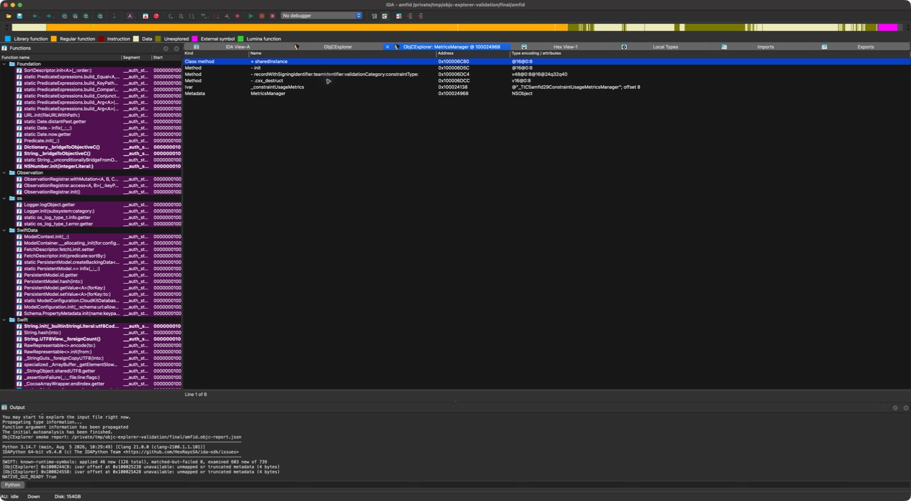
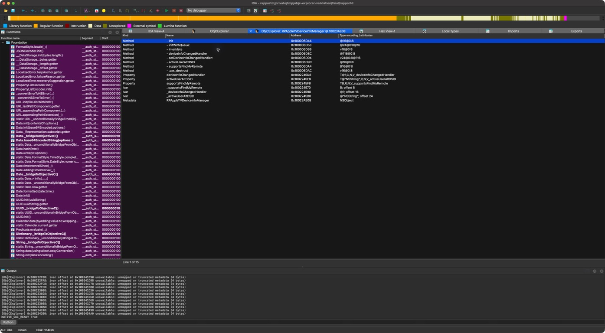

# Compatibility validation

Validation date: 2026-09-09. Host: macOS 27.0, build 26A5425a, arm64.
IDA Professional 9.4.260714.951e98a4, IDAPython SDK 940, Python 3.14.7.

## Automated fixtures

`python3 -m unittest discover -s tests -v`: **54 tests passed**. These exercise
the parser without IDA, the IDA reader and frontend with SDK mocks.
Coverage includes absolute/relative methods,
selector indirection, shared selector/type offsets, padded list entries,
protocol method kinds, categories, preattached lists, class flags, unknown ivar
offsets, 32-bit layouts, cancellation, truncated data, fixups, initialized-byte
masks, cache-header versions and old/new IDA segment APIs. Frontend tests cover
navigation, export replacement/cancellation/errors, window reuse, close behavior
and popup-hook cleanup after failed window creation.

## Real samples

The input files were copied from `/usr/libexec` into a temporary directory.
They were loaded for static analysis only. No input executables were run.
Both are arm64e Mach-O files with `LC_DYLD_CHAINED_FIXUPS`.

| Input | SHA-256 |
| --- | --- |
| `/usr/libexec/amfid` | `896ed6b66560cc7e8abdea69f42c36e51ed033962b062556ebd2e801a9910944` |
| `/usr/libexec/rapportd` | `2b77aec4cccbc947e0d2bbe54180d61fe1f3c95a18ee727879fb4d2ae12db3c4` |

`tests/ida_smoke.py` runs in IDA using **File → Script file**, after opening a
writable copy of an input. It saves `<input>.objc-report.json` and
`<input>.objc.txt` alongside that copy and opens the browser. It verifies that
metadata exists, parsing completed, and all nonzero method implementations are
mapped. The JSON report records counts, names, diagnostics, and raw/resolved
fixup samples, including low Swift class-data flags.

| Sample | Classes | Unique protocols | Categories | Methods | Properties | Ivars | Unknown ivar offsets |
| --- | ---: | ---: | ---: | ---: | ---: | ---: | ---: |
| amfid | 5 | 3 | 0 | 61 | 9 | 12 | 2 |
| rapportd | 109 | 36 | 2 | 2,901 | 652 | 1,140 | 33 |

All method, property and ivar rows matched an independent comparison using
Apple's `otool -arch arm64e -ov`, `dyld_info -fixups`, and file-backed bytes.
Method comparison includes owner, selector, encoding, instance/class kind,
optional status and implementation address. All nonzero implementations were
mapped in IDA and file-backed in the independent comparison.

`rapportd` has 41 protocol-list references to 36 distinct descriptors; the
parser deduplicates addresses. The verifier corrects `otool`'s mislabeling of
chained pointers in 175 ivar rows using `dyld_info` rebase targets. It also reads
the size-gated protocol class-property list omitted by `otool`, including
`NSSecureCoding.supportsSecureCoding`. These discrepancies were in the comparison
tool's text output, not in the plugin's final dump.

The standalone verifier is [tests/verify_macho_dump.py](../tests/verify_macho_dump.py).
It imports no project parser code and is scoped to the tested thin arm64e
Mach-O layout. For example, after running the IDA smoke script on a writable copy:

```sh
python3 tests/verify_macho_dump.py /path/to/copy/rapportd \
  --report /path/to/copy/rapportd.objc-report.json \
  --dump /path/to/copy/rapportd.objc.txt \
  --output /path/to/copy/rapportd-verified.json
```

`amfid`'s two unknown ivar offsets point
into zero-fill storage: `_$observationRegistrar` at `0x100025238` and `log` at
`0x100025A28`. The declarations remain in the dump with unknown offsets and
explicit diagnostics. `rapportd` retains 33 unknown offsets: 23 unavailable
offset cells produce diagnostics and ten unnamed ivars have null offset pointers.

## Computer-use GUI checks

Native IDA chooser navigation was exercised through the macOS GUI:

- `amfid`: opened `MetricsManager`, inspected `+ sharedInstance` with encoding
  `@16@0:8`, and double-clicked it to navigate to `0x100006C80` in disassembly.
- `rapportd`: opened `RPAppleTVDeviceInfoManager` and inspected methods,
  properties and ivars, including `- init` at `0x100006D44`.
- Invoked `oe.export(explorer.view.data)` in IDA's GUI Python console, then
  selected the destination and saved through the native save panel. The
  resulting 5,170-line file was byte-identical to the `rapportd` smoke dump.
  IDA raised a native signal-11 alert after the save panel closed; the log
  records successful export and the Python return value `True` before that alert.

The context-menu export action has SDK/mock coverage, but computer-use clicks
did not expose the menu reliably, so its full GUI interaction is unverified.
Repeated open/close behavior has mock coverage rather than a completed GUI
stress test on this host.





## Host limitations and test setup

This macOS/IDA combination repeatedly crashed during accessibility interaction,
including before this plugin ran. Sampled stacks included Qt's macOS
accessibility and native object deallocation code. Crashes occurred with Python
3.14.7 and 3.12.14. The final frontend uses native IDA choosers and imports no
Python Qt binding, but native choosers did not eliminate the host crashes.
The original Python 3.14 setting was restored after the comparison test.

The initial sample load also failed during IDA's built-in Objective-C analysis
and accessibility handling, before this plugin ran. Tests used the documented
`-Oobjc:+l` option to defer that built-in analyzer. This is a per-launch option;
the plugin does not change the user's analysis settings. See the installed
IDA help topic **Objective-C Analysis Plugin**, or
[Hex-Rays' documentation](https://docs.hex-rays.com/user-guide/plugins/plugins-shipped-with-ida/objective-c-analysis-plugin).

Testing used a temporary plugin directory added after the existing user profile
in `IDAUSR`; the plugin was not installed into the persistent user directory.
The copied samples and IDA databases were kept outside the repository.

## Coverage limits

IDA 9.0/9.1 compatibility paths, 32-bit layouts, and modern/legacy dyld cache
optimization layouts have fixture coverage; real GUI validation targets IDA
9.4 and standalone arm64e Mach-O images. A complete real shared-cache run is
still needed before claiming end-to-end support for every cache version.
Swift class flags are recognized, but native Swift reflection structures and
live realized Objective-C class metadata are outside this fix.
